# Office Guide: Admin Guide

The admin panel controls what visitors see on the digital signage (kiosk) screens
on each floor: the office guide, announcements, and the screen colours.

## Addresses

| What | Address |
|---|---|
| **Admin panel** (sign in) | http://10.100.14.6:3001/login |
| **Full office guide** (all floors) | http://10.100.14.6:3001/ |
| **Ground Floor screen** | http://10.100.14.6:3001/floor/0 |
| **1st Floor screen** | http://10.100.14.6:3001/floor/1 |
| **2nd Floor screen** | http://10.100.14.6:3001/floor/2 |
| **3rd Floor screen** | http://10.100.14.6:3001/floor/3 |
| **4th Floor screen** | http://10.100.14.6:3001/floor/4 |
| **5th Floor screen** | http://10.100.14.6:3001/floor/5 |

Each signage screen opens the address for its own floor. Changes you save appear
on the screens **within a few seconds**. Nobody needs to touch the screens.

---

## Task 1: Add an office

1. In the sidebar, open **Offices** and click **New Office**.
2. **Location:** choose the **Floor** and type the **Room number**.
   Room numbers must be unique in the whole building.
3. **Identity:** type the **Office name** in English (**EN**) and Amharic (**አማ**).
   A green dot means that language is filled in.
4. **People** (optional): the contact person, in both languages.

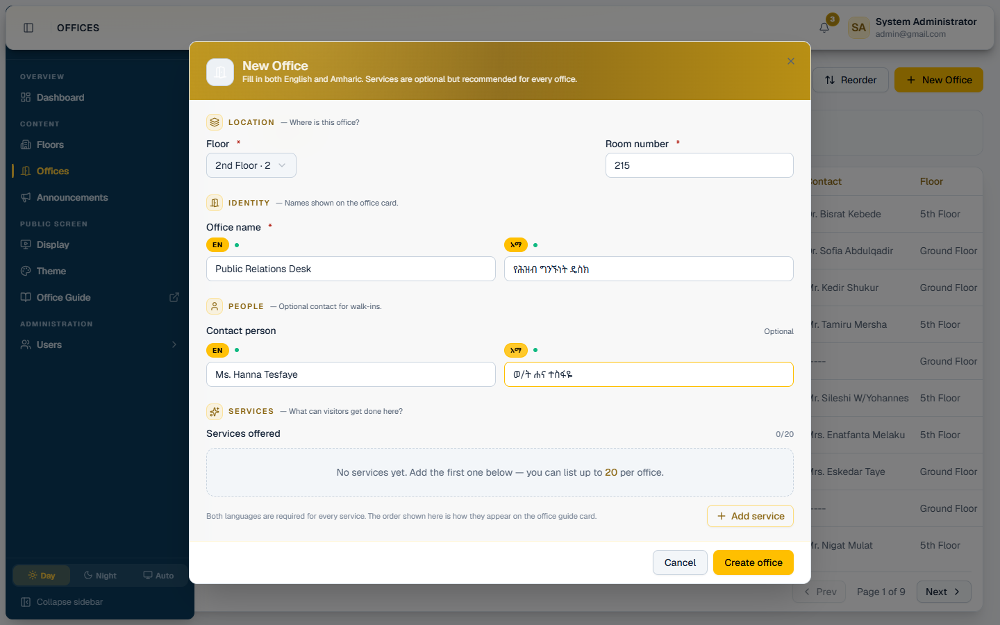

5. **Services** (recommended): click **Add service** and type what visitors can do
   at this office, in both languages. Add one row per service.
6. Click **Create office**.

The office now appears in the list. To change it later, click the pencil. To set
the order offices appear in on a floor, use **Reorder**.

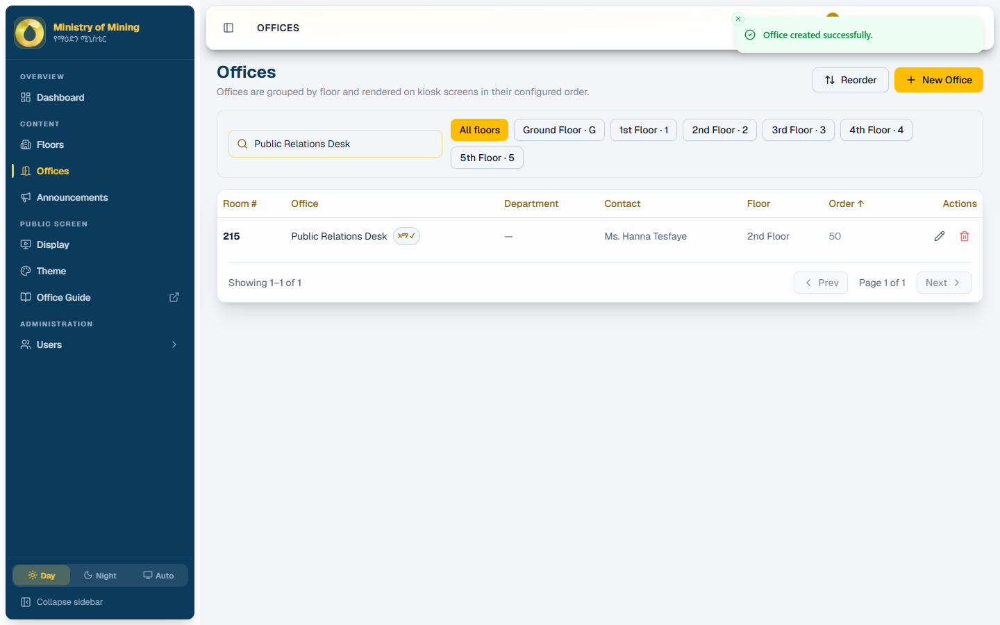

---

## Task 2: Create an announcement

1. Open **Announcements** and click **New Announcement**.
2. **Media:** click the upload area and choose an image (JPG or PNG) or a video (MP4).
   A preview appears.
3. **Title** (required) and **Caption** (optional, for your own notes).

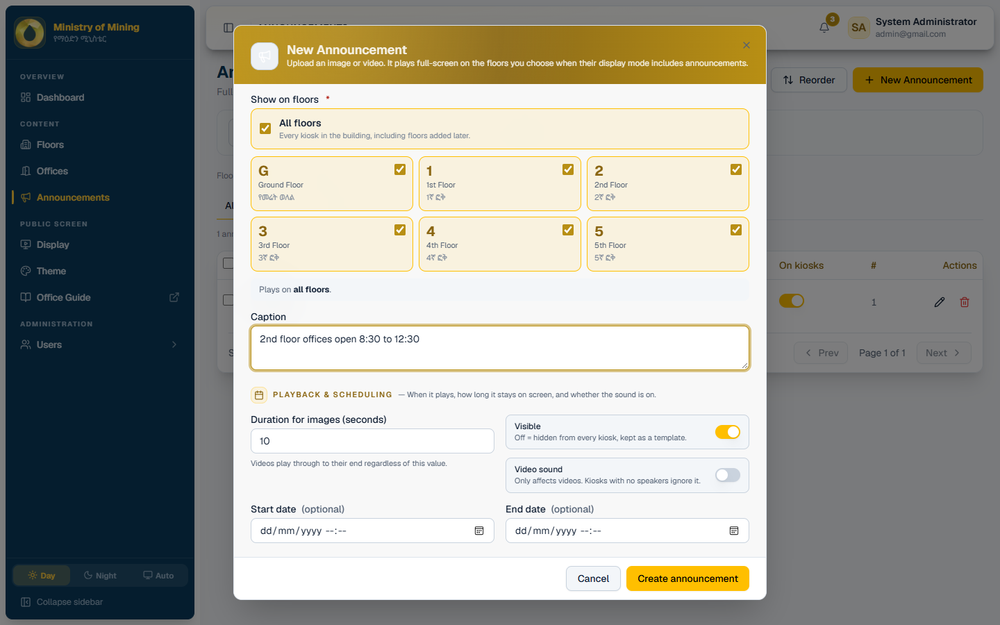

4. **Show on floors:** choose where it plays.
   - Keep **All floors** ticked to show it on every screen, including floors added later.
   - **Or** untick **All floors** and tick only the floors you want, for example only the 2nd Floor.
   - The line underneath confirms the choice, for example "Plays on 1 of 6 floors: 2nd Floor".

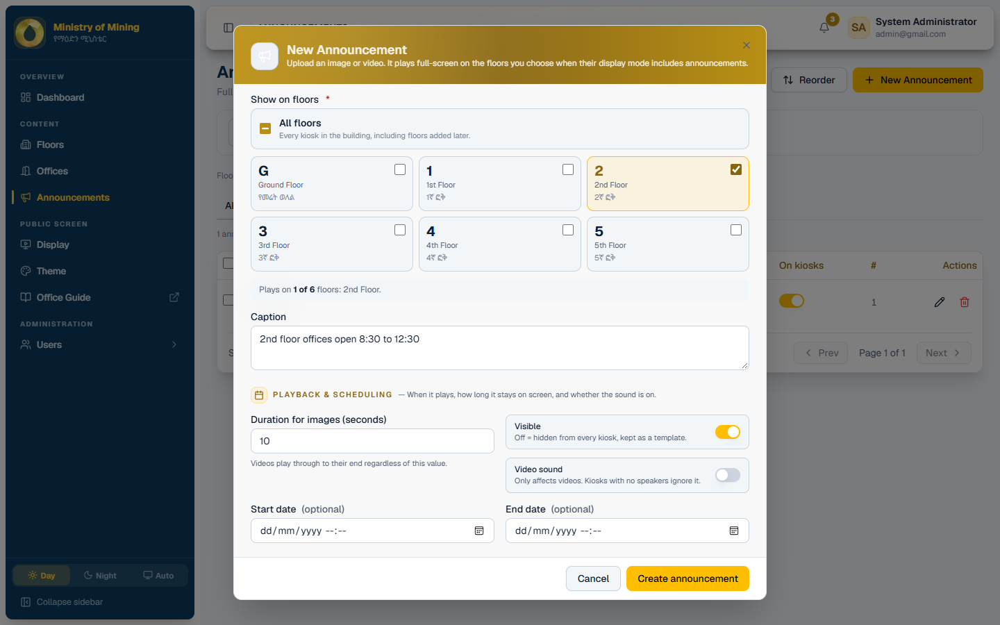

5. **Playback & scheduling:**
   - **Duration:** how many seconds an image stays on screen. Videos always play to the end.
   - **Visible:** turn off to save it without showing it yet.
   - **Video sound:** only for videos.
   - **Start / End date** (optional): it plays only between these dates and stops by itself.
6. Click **Create announcement**.

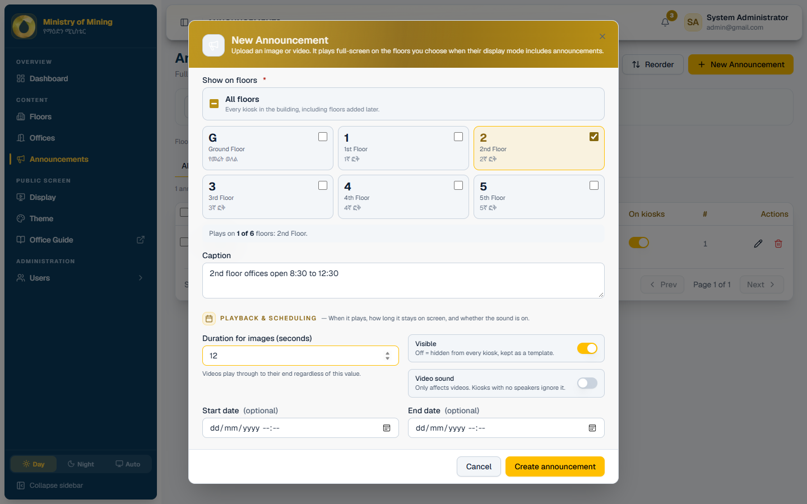

> An announcement only appears on a floor whose screen is set to show announcements.
> See Task 3.

---

## Task 3: Choose what each screen shows

Open **Display**. Each floor has its own setting:

| Mode | The screen shows |
|---|---|
| **Office guide** | Only the office directory. |
| **Announcements** | Only the announcements, full screen, one after another. |
| **Both, alternating** | The office guide for the number of seconds you set, then the announcements, then repeats. |

**Showing on all screens or only some:**
1. Use **Set all floors** to give every floor the same mode,
   **or** change the mode only on the floors you want.
2. For **Both, alternating**, set **Guide for … s** (how long the office guide stays before the announcements).
3. Click the **eye** next to a floor to see it in the **Live preview** on the right.
4. Click **Save floor settings**. Changed floors have a yellow mark until you save.

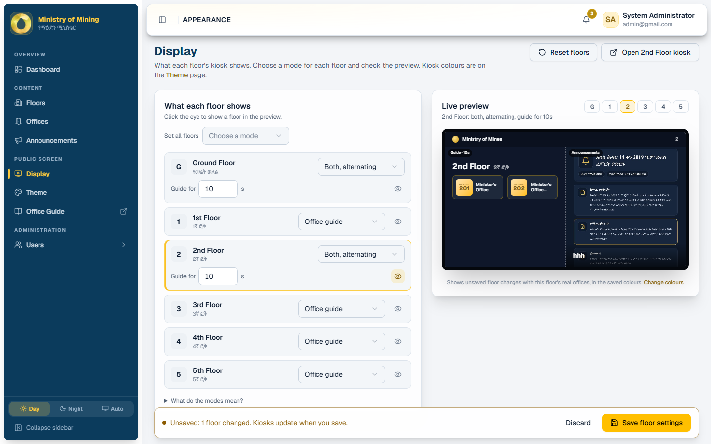

**Which announcements a floor plays** is decided in two places:
- the floors you ticked on each announcement (Task 2, step 4), and
- the **On kiosks** switch in the Announcements list, which shows or hides an
  announcement everywhere without deleting it.

To stop an announcement on one floor only, edit it and untick that floor.

---

## Task 4: Check your changes

After saving, check in any of these ways:

1. **Live preview:** on the **Display** page, click the floor's button (G, 1–5) in
   **Live preview**. It shows that floor's mode, real offices and announcements.

2. **Announcements list:** click a **floor** chip (for example **2nd Floor**) to see
   exactly what plays on that floor. The **Status** column shows:
   - **Live:** playing now
   - **Scheduled:** starts later
   - **Ended:** past its end date
   - **Hidden:** switched off

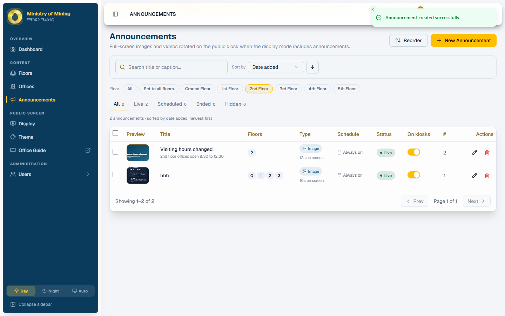

3. **Open the floor's screen** in your browser, for example
   http://10.100.14.6:3001/floor/2. Type the office name in the search box to find a
   new office.

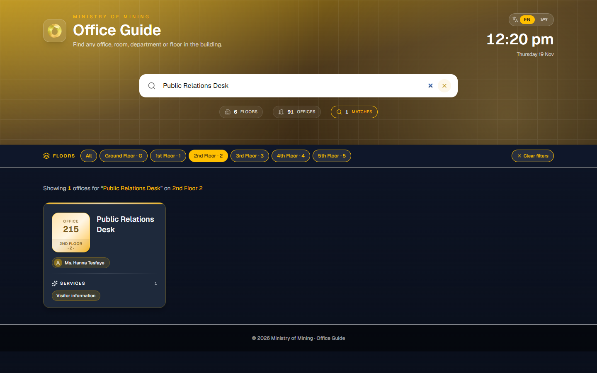

   With **Both, alternating**, the screen shows the office guide first, then the
   announcements:

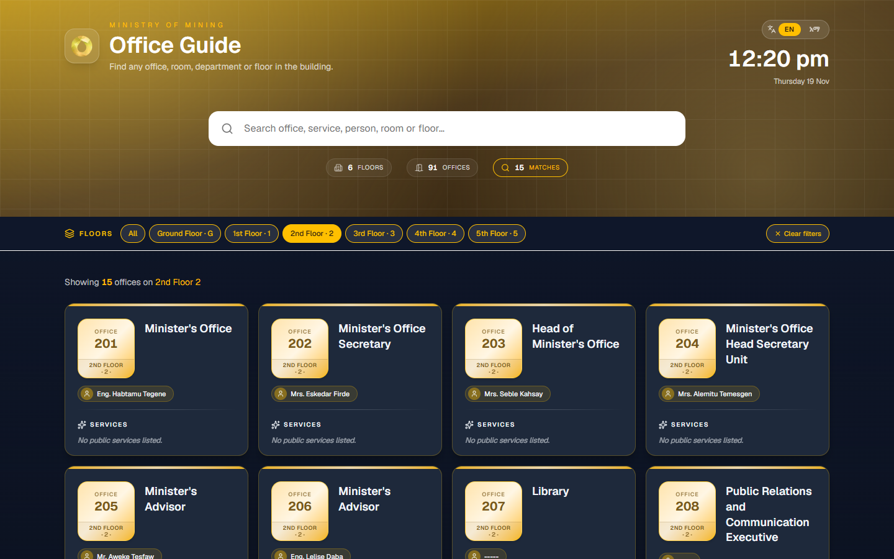
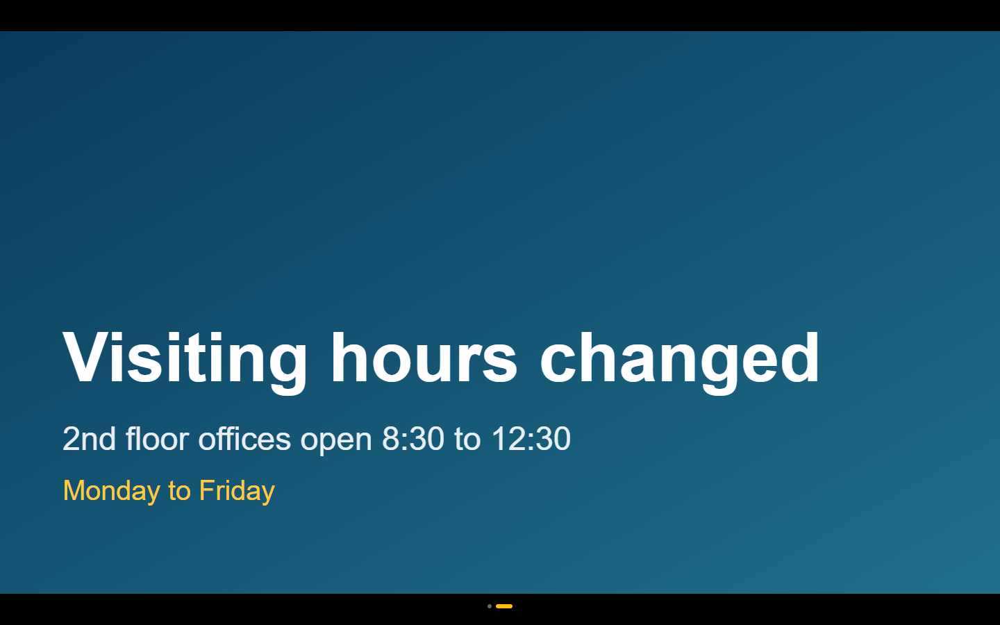

4. **On the physical screen:** walk to the floor or ask someone there. Changes appear
   within a few seconds.

**If a change doesn't appear:**
- Check that you clicked **Save**.
- For announcements, check the **Status** column, the **On kiosks** switch, the ticked
  floors, and the start date.
- Check that the floor's **Display** mode includes announcements.
- As a last resort, refresh the screen's browser (**F5**).

---

## Other pages

- **Dashboard:** building overview: floors, offices, translation coverage, offices missing Amharic.
- **Floors:** add or edit floors (number, English and Amharic name, active). Inactive floors are hidden from the screens.
- **Theme:** the colours of all screens. Pick a preset, check the preview, click **Save theme**.
- **Users:** add users (they receive a temporary password by email), activate or deactivate, reset passwords. **Roles** and **Permissions** control what each user can do.
- **Profile** (your name, top-right): your details and **Change password**. A new password must be at least 8 characters and different from the current one.
- **Day / Night / Auto** (bottom of the sidebar): the admin panel's own colours. This doesn't change the screens.

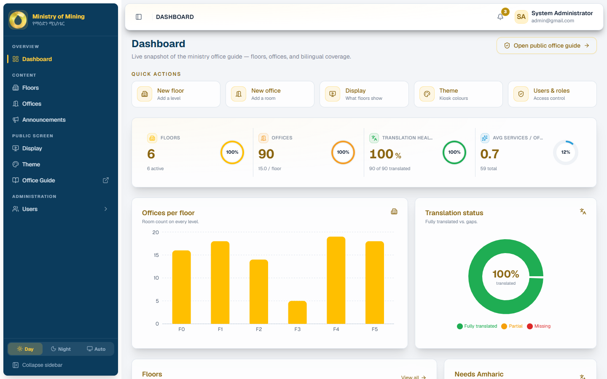
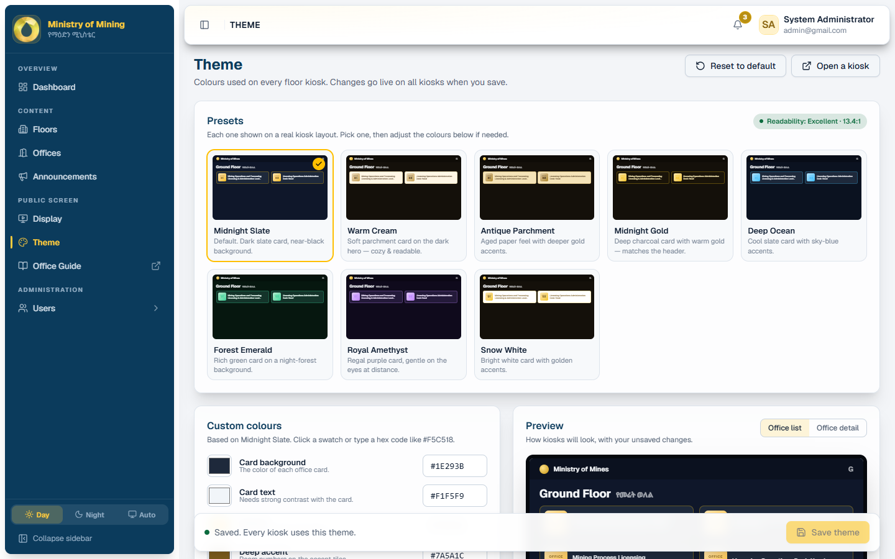
